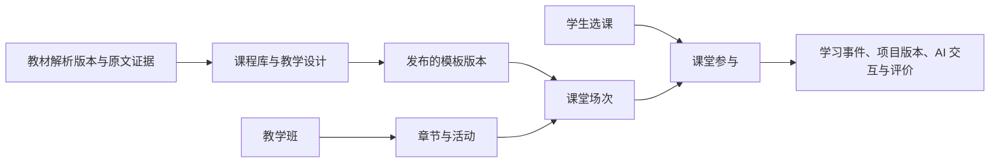

# CoTeach 系统架构

CoTeach 的应用与教学服务在同一 Next.js 工程中实现。PostgreSQL 保存业务事实和任务，Redis 提供缓存、限流及实时消息传递，文件存储保存教材、上传、课堂媒体和白板。当前部署拓扑见[部署说明](../deploy/README.md)。

## 教学设计与授课分离

`CourseOffering` 组织长期教学班，`Chapter` 和 `Activity` 组织教学内容与开放状态，`Enrollment` 记录学生的课程访问。普通活动的当前进度与提交历史分别保存。

`ClassroomTemplate` 保存可编辑教学设计，`ClassroomTemplateVersion` 保存发布快照，`ClassroomInstance` 保存某次授课的运行配置，`ClassroomParticipation` 绑定该场学生。进入待授课场次与开始授课是两个动作；再次授课建立新场次，完成与未完成记录按各自场次留存。

当前五阶段配置是项目启动、知识讲授、项目实践、成果汇报与评价、后测。实验测评绑定课堂活动与场次，草稿和正式答卷分开保存。反思等历史字段仍可被兼容代码读取，其存在不改变当前阶段定义。

教材的文档、解析版本、章节、证据、图片、知识关系和检索向量独立管理。课程确认的来源绑定具体版本与证据；后续教材重新解析不应静默替换已确认的教学来源。生成任务的质量、页面归属与恢复规则见[课程生成合同](course-generation.md)。

## 接口与权限

| 接口族 | 职责与入口 |
| --- | --- |
| `/api/platform/auth/*` | 教师与学生注册、登录、加入教学班及账号操作 |
| `/api/platform/offerings/*`、`activities/*` | 教学班、章节、活动、问卷、实验测评及研究导出 |
| `/api/platform/templates/*`、`classroom-instances/*`、`participations/*` | 课程模板、发布版本、课堂场次和学生参与 |
| `/api/textbooks/*` | 教材导入、解析进度、章节阅读与检索 |
| `/api/courses/*` | 现存备课任务、资源、版本、课堂动作和成果适配；具体子路由各自校验模板或场次作用域 |
| `/api/openmaic/*` | 文档解析、课件内容、播放器媒体及 AI Provider 适配 |
| `/api/ai-collaboration/*` | 文档与代码协作、执行、事件与审计 |

退役的登录、旧课程集合和旧压测写入入口返回 `410`；不能据此把整个 `/api/courses/*` 视为退役。开发时从实际路由和调用方核对作用域，模板 ID、场次 ID、参与 ID 与教学班 ID 不可混用。

认证使用统一用户与数据库会话版本。服务端按角色、选课关系、模板所有权、课堂参与和文件归属校验；客户端传来的身份与模型正文不能替代权限依据。Provider 凭据集中加密保存，运行期配置与业务数据库可通过明确的共享 Provider 配置连接分开管理。

## Provider 与课堂工具

教师在“个人中心 → AI 服务”管理各能力。语言模型验证与图片、视频、搜索、ASR、PDF、向量检索的[能力测试](../src/app/api/openmaic/test-provider/route.ts)分别使用实际协议和配置。测试成功只证明本次对应调用结果，不能推断其他能力或整课质量。TTS 使用生成后的样本与实测音频时长校准，校准绑定 Provider、模型、音色、语言和速度；配置改变后应重新核对，课程预算与最终实测时长分别保存。

实时课堂默认使用 [AI SDK 原生教学工具](../src/lib/openmaic/orchestration/native-teaching-tools.ts)，按角色允许动作和当前场景构造工具集，参数与动作权限在服务端校验。工具最终编译成共享 Action DSL 和 SSE 动作事件，由播放器执行并留存；供应商在尚无文本或动作输出时失败，可进入结构化动作兼容路径。`OPENMAIC_NATIVE_CLASSROOM_TOOLS=false` 可明确关闭原生工具模式。

| 工具 | 教学职责 |
| --- | --- |
| 白板 | 按步骤展开推理、计算、变换和图示，讲解与书写同步，结束后返回页面。 |
| 理解检查 | 收集当前预测、选择或简答，等待学生响应；与正式计分测验分开。 |
| 证据板 | 保存主张、依据与推理，真实区分已核验和待核验来源。 |
| 互动 widget | 设置变量、强调对象和展示结果；操作成功不代表学生已经掌握。 |

PPT 保留稳定结构、结论和需要持续观察的材料，白板处理需要逐步展开的过程。选择依据教学任务和实际内容，不能靠学科关键词或固定动作配额决定；生成与播放使用同一动作与页面生命周期。

## 文档与代码协作

学生项目工作区读取正在编辑的内容及课程要求，使用该场参与身份保存草稿、成果版本和 AI 过程。文档与代码的当前正式入口均采用建议后确认：AI 的批注和建议先展示，实际变更由学生确认后应用。关键问题、核心方案、核心结论与最终提交保留学生责任。

- 文档建议绑定原文、选区或段落，应用前核对版本与锚点。已经改变的内容不能被迟到建议覆盖；接受、拒绝和撤销分别留痕。
- 主动批注结合全文、课程事实与发生变化的段落判断，正常保存不等于必须产生批注。重复问题、已处理的问题和失效锚点有独立判断。
- 代码使用 Monaco 文件工作区，Python 与 C 草稿按成果类型保存。建议以文件与行范围定位，通过差异预览确认；运行结果来自代码运行器。
- 代码运行器是独立的内部鉴权服务，使用 Bubblewrap 隔离执行和资源限制。Next.js 通过[运行器客户端](../src/lib/code-runner/client.ts)调用；服务缺失时显示不可用，不直接在 Web 进程执行学生代码。
- 草稿保存、最终归档、文件上传与 AI 请求使用各自稳定身份和幂等回执；冲突、断网与在途任务不能被显示成成功。

AI 原始请求、模型输出、工具/任务状态、建议决策与审计分别持久化，待补写审计队列支持恢复。教师监控读取该场过程证据；课件编辑 Agent 的浏览器对话历史是另一套存储，见[编辑 Agent 说明](../src/lib/openmaic/agent/README.md)。

仍保留的伴学适配采用证据、优先级和冷却控制主动发言，正常保存保持安静，明确求助和有效里程碑可以触发。学习预警只针对当前有效阶段和页面观察范围，不因学生没有使用可选 AI 工具而自动判定风险；教师数字的分母、去重和评分口径见[指标说明](teacher-metrics.md)。

## 学习播放与白板

知识讲授复用发布的教学资源，主课负责完整教学，测验按知识点形成可核对评分与解释证据。已有且已确认的个性化方案可在同一播放器编排先修补学与拓展；默认生成入口与兼容方案的边界见[个性化学习合同](quality/adaptive-learning.md)。

普通小测首轮使用预生成的逐题通讲与语音，覆盖单选、多选、判断、配对及底层简答类型的填空题。讲解按课堂、页面、完整题目与采用证据的指纹查询，不随学生答案变化；打开、重播或资源缺失均不触发模型或实时语音合成。资源缺失时展示原题解析或参考答案，语音不可用时可由浏览器朗读。深度简答和学生主动追问保留个人上下文与请求幂等。

课程保存、发布和开课原子写入同一份内容预热回执；后台先核对课堂版本并固化题目及证据，再利用数据库租约逐题准备资源。文本和音频分别持久化，音频失败后仅补语音，单题失败继续处理其余题目。共享资源不进入课件播放动作，不改变教学时长或学生成绩；浏览记录与真实AI追问分别留痕。

课堂页面白板按 `whiteboard-scene:<sceneId>` 隔离。当前页的动作、画布和清空只作用于该页，返回前页恢复原板书；历史无作用域白板保留但不自动叠加。实时协作白板的服务与课堂页板书各有职责，不能用另一页内容遮盖写入失败。

## 实时同步与恢复

WebSocket 传递课堂与投屏更新，Redis Pub/Sub 提供跨进程通知，数据库领域事件游标负责断线补漏。客户端保持事件补读与状态校验：WebSocket 正常时事件轮询为 5 秒，失效时为 1 秒；投屏还有独立轻量路径，其时序常量以[投屏策略](../src/lib/realtime/projection-state.ts)为准。

页面和播放状态使用单调版本及当前控制者守护，过时响应不能覆盖较新状态。在线人数来自 presence，已进入人数来自参与记录，二者分开统计。后台标签页减少轮询；重新可见与重连后重新核对当前事实。

启用后台生成时，持久任务由服务启动的 worker 接管，页面离开不代表任务取消；显式关闭后台模式时由请求的 `after` 处理。发布版本、生成请求、教材来源、学生草稿和媒体指纹各自决定能否复用；恢复须返回实际失败源头并保留已经完成的阶段。

## 原始资源与派生资源

`FileAsset` 记录 SHA-256、来源、作用域、源文件依赖和重建配方。`REQUIRED` 表示需保留的资源，`REGENERATE` 表示已有可执行重建配方的派生资源，`EPHEMERAL` 表示临时资源；AI 生成本身不构成可丢弃依据。

PPTX 原件与 PDF 预览关联保存，受控转换可重建预览；讲稿、Provider、音色等完整配方可用于缺失语音恢复。恢复工具见[资源重建入口](../scripts/rehydrate-storage.ts)。当前本机完整备份实际保存完整课堂媒体，备份范围以[备份实现说明](../deploy/backup/README.md)为准。

PostgreSQL 保存关系与研究事实，文件保存二进制和课堂内容，Redis 不承担唯一持久记录。上传下载、孤立文件清理和恢复必须同时核对归属、引用及摘要。研究留存和导出权限见[研究数据完整性](database/research-integrity.md)与[研究导出](database/research-export.md)。
